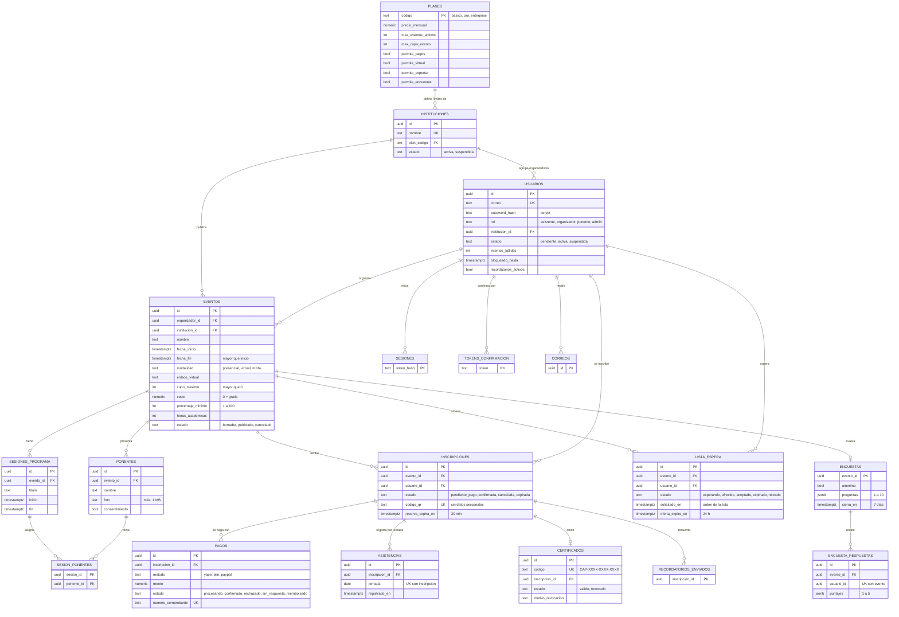
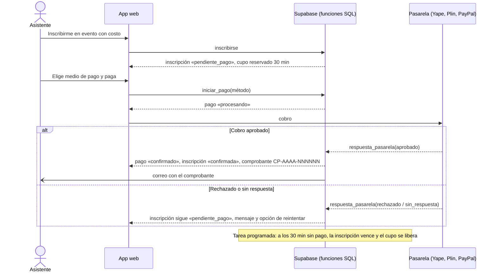

# Diagramas de CAPACITRON

GitHub dibuja estos diagramas (Mermaid) directamente al abrir el archivo. Para adjuntarlos como PNG, ábrelos en <https://mermaid.live>, pega el bloque y descarga la imagen.

## 1. Modelo entidad-relación (esquema `capa`)

Fuente: [supabase/migrations/20261005000001_esquema.sql](../supabase/migrations/20261005000001_esquema.sql).

Tablas de apoyo sin relación con las anteriores: `config` (reloj de demostración), `verificaciones` y `bloqueos_verificacion` (HU-09), `auditoria` (historial inmutable, HU-13) y `public.actividad_eventos` (señal de tiempo real, HU-10).

## 2. Secuencia del pago en línea (HU-04)

Fuente: funciones `public.iniciar_pago` y `public.respuesta_pasarela` en [20261005000002_funciones_base.sql](../supabase/migrations/20261005000002_funciones_base.sql) y [20261005000006_endurecimiento.sql](../supabase/migrations/20261005000006_endurecimiento.sql).

En esta versión la pasarela es un simulador dentro de la app y solo funciona con el modo demostración activo.
